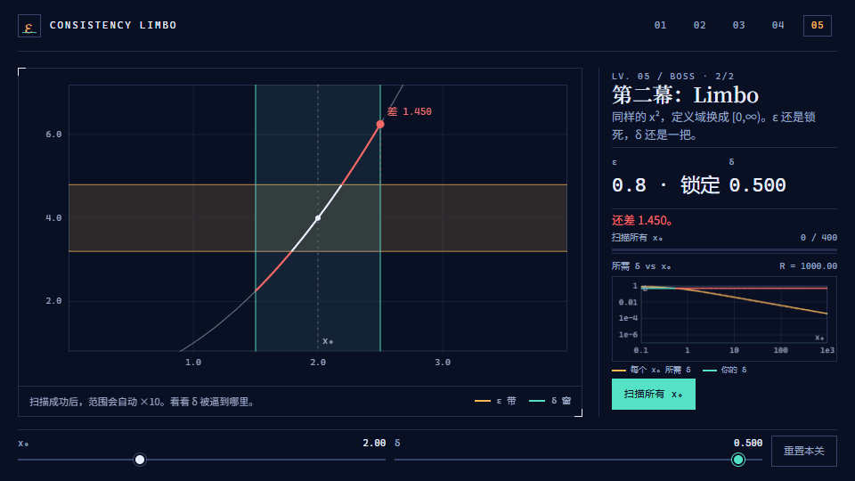

# Consistency Limbo

给学数学分析的人：把 ε-δ 和一致连续拖出来，看见为止。

*An interactive ε-δ playground for real-analysis students — drag until continuity clicks.*

<p align="center">
  
</p>

<p align="center">
  <a href="https://nddcv1.github.io/consistency-limbo/"><strong>在线玩</strong></a>
  ·
  <a href="https://nddcv1.github.io/consistency-limbo/?level=boss">直接挑战 boss</a>
</p>

**5 关 · 5 分钟 · 无后端。** 打开就能拖，不用注册，不用安装。

## 这是什么

每一关都是一张函数图像、一条琥珀色的 ε 带、一个青绿色的 δ 窗。拖 δ，让窗口里的曲线全部落进带子，窗口就会变绿。

前四关把这套“全绿”的直觉练熟；第五关把 ε 锁死，只给你一把 δ，然后让 x₀ 越跑越远。

## 五关

| # | 关卡 | 你会看见 |
|---|---|---|
| 01 | 热身：x² | 带子和窗口第一次同时出现 |
| 02 | 同一个 f，不同的 x₀ | 每个位置允许的最大 δ 不同 |
| 03 | 抖动：sin(x²) | 局部再凶，δ 足够小仍然能全绿 |
| 04 | 边界：1/x | 越靠近 0 越陡；x = 0 没有定义 |
| 05 | 一致连续 Limbo | 先在 [0,1] 成功，再在 [0,∞) 撞墙 |

## Boss 关为什么反直觉

逐点连续是：对每个 x₀，你都能找到自己的 δ。  
一致连续是：**同一把 δ 要管住所有 x₀。**

第二幕里，每次你觉得找到了，范围就自动 ×10。任何固定的 δ 都会在更远处被击穿。右侧包络图画出“每个 x₀ 至少需要多小的 δ”，你的 δ 是一条横线——横线永远压不到曲线下方。

这不是形式证明；它是一次可以亲手撞上的演示。README 的已知限制里写清了这一点。

## 和现有 ε-δ 工具的区别

ε-δ 交互工具并不空白：

- [KU Leuven Continuity Checker](https://kulak.kuleuven.be/facult/wet/wiskunde/ooi/applets_shu/Math/Calculus/Ira/Continuity.html) 已有 Simple / Uniform 模式；
- [GeoGebra Epsilon-Delta Game](https://www.geogebra.org/m/YhZNXyzm) 已经能拖 ε、δ；
- [Vanishing Point](https://playpendium.com/vanishing-point/) 已经是带关卡和评分的游戏。

Consistency Limbo 做的是另一件事：把一致连续包装成一场有开场、有升级、有收尾的 boss 战，用一张包络图把“没有统一 δ”画出来；同时保持开源、零安装、中文优先。

## 本地运行

不需要安装依赖就能玩和跑测试：

```bash
npm test
npm run serve
# 打开 http://localhost:8000
```

生成 README 的 GIF 才需要安装开发依赖：

```bash
npm install
npm run demo:gif
```

## 已知限制

- 判定用数值采样（1024 点 + 0.1% 安全余量），不是形式证明；预设函数的采样很密，但极窄尖峰仍可能被漏掉。
- v0.1 只有 5 个预设关卡，不支持输入任意函数。
- Boss 第二幕是引导式演示：游戏展示所需 δ → 0 的趋势，并让你自己撞墙；它不声称替代数学证明。
- 桌面优先；窄屏可操作，但没有单独设计移动版。

## Roadmap（v0.2+，不是 v0.1）

- 白名单表达式解析，支持自定义函数。
- 更多知识点：导数、Riemann 积分、级数、开覆盖。
- 可分享的关卡状态 URL 和课堂大屏模式。
- 英文 UI 与双语 README。

## License

MIT © 2026 nddcv1

---

如果它帮你第一次“看见”了 ε-δ，点个 star 让更多人看到。
